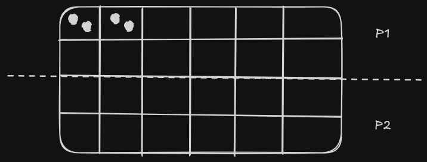

## KATRO

### Description

Katro is a traditional board game from Madagascar.

### Features
 - Animation
 - Bot/PvP game type
 - Game Mode
 - 

### Controls

Keyboard:
 - UP/DOWN/LEFT/RIGHT ENTER

Mouse

### Screenshots

_TODO: Show your game to the world, animated GIFs recommended!._

<!-- ### Links

 - YouTube Gameplay: $(YouTube Link)
 - itch.io Release: $(itch.io Game Page)
 - Steam Release: $(Steam Game Page) -->

### License

This project sources are licensed under an unmodified zlib/libpng license, which is an OSI-certified, BSD-like license that allows static linking with closed source software. Check [LICENSE](LICENSE) for further details.

*Copyright (c) 2026 Luca RANDRIANIRINA Luca-coder07*
